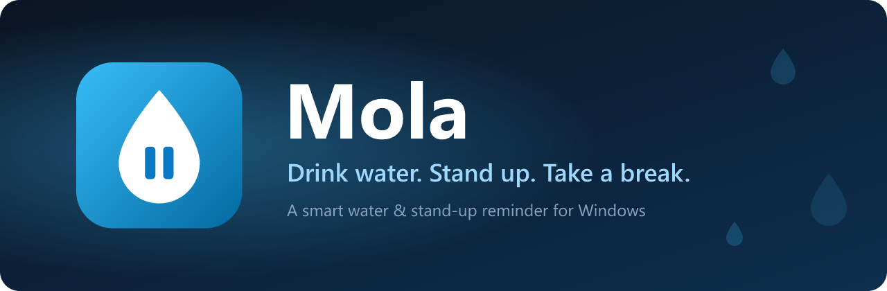
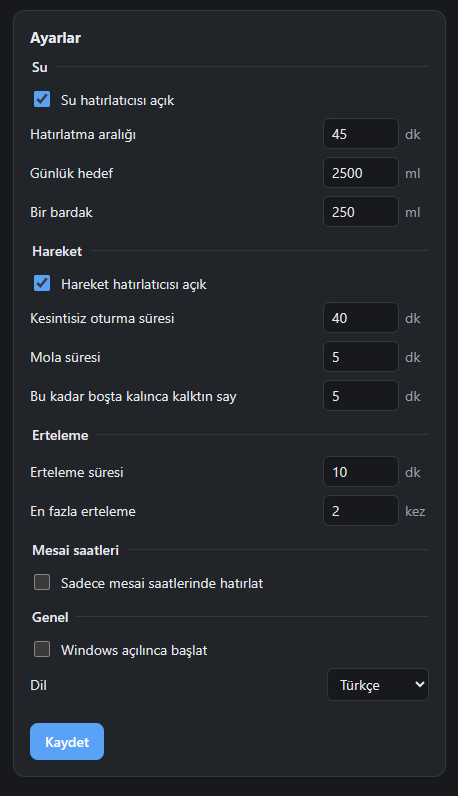
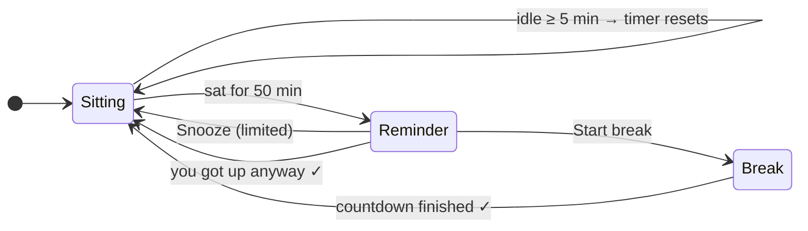

<p align="center">
  
</p>

<p align="center">
  
  
  
  
  
</p>

<p align="center">
  <b>English</b> · <a href="README.tr.md">Türkçe</a>
</p>

---

**Mola** (Turkish for *break*) is a tiny tray app that reminds you to **drink water** and to **get up from your desk**. It knows when you have already stepped away, so it won't nag you after lunch. And because snoozes are limited, you can't put off your break forever.

<table>
  <tr>
    <td width="45%" align="center">
      
    </td>
    <td width="55%">
      <h3>💧 Water</h3>
      Reminders at your own interval, a daily goal, and one-click <i>"I drank"</i> logging.
      <h3>🚶 Movement</h3>
      Tracks <b>continuous</b> sitting time. Step away from the keyboard and mouse for a few minutes and the timer resets on its own.
      <h3>⏱️ Real breaks</h3>
      A countdown with stretching tips, in a small always-on-top window, not a toast you can miss.
      <h3>🔒 Limited snoozes</h3>
      Snooze up to <i>N</i> times. After that, it's time to move.
    </td>
  </tr>
</table>

## ✨ Features

| | |
|---|---|
| 💧 **Water reminders** | Custom interval, daily goal and glass size, progress bar |
| 🚶 **Smart sitting timer** | Uses Windows idle time: being away counts as a break |
| 🪟 **Custom reminder window** | Bottom-right corner, always on top, harder to miss than a notification |
| 🔁 **Snooze limit** | Configurable snooze length and maximum count |
| ⏱️ **Guided breaks** | Countdown with rotating stretch and eye-rest tips |
| 📊 **Dashboard** | Today's water and breaks, plus the last 7 days at a glance |
| 🕘 **Working hours** | Remind only between set hours, optionally weekdays only |
| ⏸️ **Pause** | "Pause for 1 hour" from the tray, for meetings |
| 🚀 **Start with Windows** | Starts quietly in the tray |
| 🌍 **Turkish & English** | Follows your system language, switchable at any time |
| 🌗 **Light & dark** | Follows your Windows theme |

## 🧠 How the movement timer works



All the numbers (50 min, 5 min, snooze count…) can be changed in the settings.

## 🔐 Privacy

Mola **never records keystrokes or mouse movement**. It asks Windows a single question, *"how many seconds since the last input?"* ([`GetLastInputInfo`](src-tauri/src/idle.rs)). Settings and daily stats are stored as plain JSON in `%APPDATA%\app.mola.desktop\`. The app makes **no network requests**. The code is open, so you can check this yourself.

## 📦 Install

> Prebuilt installers are coming soon through GitHub Releases, winget and the Microsoft Store.
> Until then, you can build Mola from source.

## 🛠️ Build from source

**Requirements:** [Node.js](https://nodejs.org) 20+, [Rust](https://rustup.rs) (stable), and the Microsoft C++ Build Tools ([Tauri prerequisites](https://tauri.app/start/prerequisites/)).

```sh
git clone https://github.com/furkanuysl/Mola.git
cd Mola
npm install

npm run tauri dev                 # run in development mode
cd src-tauri && cargo test        # run the timer tests
npm run tauri build               # build the installer → src-tauri/target/release/bundle/nsis
```

<details>
<summary><b>Project structure</b></summary>

```
src-tauri/src/
├─ engine.rs     # timer logic: pure and unit-tested
├─ store.rs      # settings, history, JSON persistence
├─ idle.rs       # Windows idle time (GetLastInputInfo)
├─ i18n.rs       # tray menu texts (tr/en)
└─ lib.rs        # tray, windows, commands, 1-second tick loop
src/
├─ Dashboard.tsx # dashboard and settings
├─ Reminder.tsx  # reminder / break window
└─ i18n.ts       # UI translations (tr/en)
design/          # icon and banner sources (SVG)
```

</details>

## 🗺️ Roadmap

- [x] Water & movement reminders with smart idle reset
- [x] Limited snoozes, guided breaks, 7-day history
- [x] Turkish & English
- [ ] Don't interrupt during fullscreen apps, presentations and video calls
- [ ] Eye-rest reminders (20-20-20 rule)
- [ ] Streaks and weekly summary
- [ ] Releases on GitHub, winget and the Microsoft Store

Ideas and bug reports are welcome. Open an [issue](https://github.com/furkanuysl/Mola/issues).

## 📄 License

[MIT](LICENSE) © furkan-uysal
