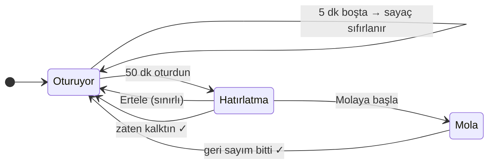

<p align="center">
  
</p>

<p align="center">
  
  
  
  
  
</p>

<p align="center">
  <a href="README.md">English</a> · <b>Türkçe</b>
</p>

---

**Mola**, sistem tepsisinde çalışan küçük bir uygulama: sana **su içmeyi** ve **masadan kalkmayı** hatırlatır. Zaten kalktığını anlar, bu yüzden öğle yemeğinden dönünce boşuna uyarmaz. Erteleme hakkın da sınırlı, molayı sonsuza kadar öteleyemezsin.

<table>
  <tr>
    <td width="45%" align="center">
      
    </td>
    <td width="55%">
      <h3>💧 Su</h3>
      Kendi belirlediğin aralıkla hatırlatma, günlük hedef ve tek tıkla <i>"İçtim"</i> kaydı.
      <h3>🚶 Hareket</h3>
      <b>Kesintisiz</b> oturma süresini sayar. Birkaç dakika klavye ve fareden uzak kalırsan sayaç kendiliğinden sıfırlanır.
      <h3>⏱️ Gerçek molalar</h3>
      Esneme önerileriyle geri sayım. Kaçırılabilecek bir bildirim değil, her zaman üstte duran küçük bir pencere.
      <h3>🔒 Sınırlı erteleme</h3>
      En fazla <i>N</i> kez ertelersin. Sonrasında kalkma vakti.
    </td>
  </tr>
</table>

## ✨ Özellikler

| | |
|---|---|
| 💧 **Su hatırlatıcısı** | Ayarlanabilir aralık, günlük hedef ve bardak boyutu, ilerleme çubuğu |
| 🚶 **Akıllı oturma sayacı** | Windows boşta kalma süresini kullanır: uzakta olmak mola sayılır |
| 🪟 **Özel hatırlatma penceresi** | Sağ alt köşede, her zaman üstte; bildirimden daha zor kaçırılır |
| 🔁 **Erteleme sınırı** | Erteleme süresi ve en fazla erteleme sayısı ayarlanabilir |
| ⏱️ **Rehberli mola** | Değişen esneme ve göz dinlendirme önerileriyle geri sayım |
| 📊 **Panel** | Bugünkü su ve molalar, son 7 günün özeti |
| 🕘 **Mesai saatleri** | Sadece belirli saatlerde, istersen sadece hafta içi hatırlatır |
| 🎧 **Rahatsız etme** | Görüşmedeyken ya da tam ekran uygulamadayken (oyun, sunum, video) bekler, bitince hemen hatırlatır |
| ⏸️ **Duraklatma** | Toplantılar için tepsiden "1 saat duraklat" |
| 🚀 **Windows ile başlama** | Sessizce tepside başlar |
| 🌍 **Türkçe ve İngilizce** | Sistem dilini izler, istediğin an değiştirebilirsin |
| 🌗 **Açık ve koyu tema** | Windows temanı izler |

## 🧠 Hareket sayacı nasıl çalışır?



Bütün süreler (50 dk, 5 dk, erteleme sayısı…) ayarlardan değiştirilebilir.

## 🔐 Gizlilik

Mola **tuş vuruşlarını veya fare hareketlerini asla kaydetmez**. Windows'a tek bir soru sorar: *"son girdiden bu yana kaç saniye geçti?"* ([`GetLastInputInfo`](src-tauri/src/idle.rs)). Görüşmeleri algılamak için yalnızca mikrofonun bir uygulama tarafından *kullanılıp kullanılmadığına* bakar. Bu bilgi, Windows'taki "mikrofon kullanılıyor" simgesinin kaynağı olan kayıttan okunur. Sese asla erişmez ([`busy.rs`](src-tauri/src/busy.rs)). Ayarlar ve günlük istatistikler `%APPDATA%\app.mola.desktop\` altında düz JSON olarak saklanır. Uygulama **hiçbir ağ isteği yapmaz**. Kod açık, kendin de kontrol edebilirsin.

## 📦 Kurulum

> Hazır kurulum dosyaları yakında GitHub Releases, winget ve Microsoft Store üzerinden gelecek.
> O zamana kadar kaynak koddan derleyebilirsin.

## 🛠️ Kaynaktan derleme

**Gereksinimler:** [Node.js](https://nodejs.org) 20+, [Rust](https://rustup.rs) (stable) ve Microsoft C++ Build Tools ([Tauri gereksinimleri](https://tauri.app/start/prerequisites/)).

```sh
git clone https://github.com/furkanuysl/Mola.git
cd Mola
npm install

npm run tauri dev                 # geliştirme modunda çalıştır
cd src-tauri && cargo test        # zamanlayıcı testleri
npm run tauri build               # kurulum dosyası → src-tauri/target/release/bundle/nsis
```

<details>
<summary><b>Proje yapısı</b></summary>

```
src-tauri/src/
├─ engine.rs     # zamanlayıcı mantığı: saf, birim testli
├─ store.rs      # ayarlar, geçmiş, JSON kalıcılığı
├─ idle.rs       # Windows boşta kalma süresi (GetLastInputInfo)
├─ busy.rs       # tam ekran ve görüşme algılama
├─ i18n.rs       # tepsi menüsü metinleri (tr/en)
└─ lib.rs        # tepsi, pencereler, komutlar, saniyelik döngü
src/
├─ Dashboard.tsx # panel ve ayarlar
├─ Reminder.tsx  # hatırlatma / mola penceresi
└─ i18n.ts       # arayüz çevirileri (tr/en)
design/          # ikon ve banner kaynakları (SVG)
```

</details>

## 🗺️ Yol haritası

- [x] Akıllı sıfırlamalı su ve hareket hatırlatmaları
- [x] Sınırlı erteleme, rehberli mola, 7 günlük geçmiş
- [x] Türkçe ve İngilizce
- [x] Tam ekran uygulama, sunum ve görüntülü görüşme sırasında rahatsız etmeme
- [ ] Göz molası hatırlatıcısı (20-20-20 kuralı)
- [ ] Seri sayacı ve haftalık özet
- [ ] GitHub Releases, winget ve Microsoft Store'da yayın

Fikirlerini ve hata bildirimlerini bekliyorum: bir [issue](https://github.com/furkanuysl/Mola/issues) aç.

## 📄 Lisans

[MIT](LICENSE) © furkan-uysal
